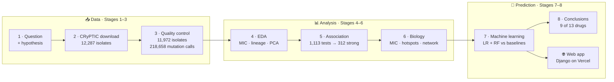
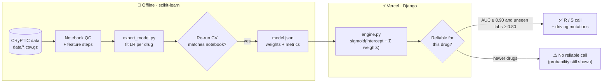

<p align="center">
  
</p>

<p align="center">
  <a href="https://tb-resistance-predictor.vercel.app">
    
  </a>
</p>

<p align="center">
  <a href="https://tb-resistance-predictor.vercel.app"></a>
  <a href="https://colab.research.google.com/github/EKR4T/bioinformaticsproject/blob/main/tb-resistance-mutations/TB_resistance_mutations.ipynb"></a>
  <a href="https://doi.org/10.1371/journal.pbio.3001721"></a>
  
</p>

<p align="center">
  <a href="#-what-is-this-project">About</a> ·
  <a href="#-the-pipeline">Pipeline</a> ·
  <a href="#-key-findings">Findings</a> ·
  <a href="#-the-model">Model</a> ·
  <a href="#-web-app-and-api">Web app</a> ·
  <a href="#-getting-started">Getting started</a> ·
  <a href="#-team">Team</a>
</p>

---

## 🧬 What is this project?

*Mycobacterium tuberculosis* does not pick up resistance genes from other bacteria. It becomes resistant through mutations in its own chromosome, in the gene for a drug's target or for the enzyme that activates the drug. That makes resistance something you can read from the genome.

**Research question:** *Which specific genetic mutations in M. tuberculosis are most strongly linked to antibiotic resistance?*

We link the mutations in **43 known and candidate resistance genes** to laboratory drug-susceptibility results for **13 antibiotics** in **11,972 clinical isolates** from the CRyPTIC consortium. For each mutation we:

1. **Measure** its association with resistance (odds ratio, Fisher's exact test, Benjamini–Hochberg FDR, PPV).
2. **Check** that the link survives lineage adjustment and holds when the mutation is carried alone.
3. **Interpret** the top hits biologically: MIC shift, protein hotspots, a drug–mutation network and the literature.
4. **Predict** resistance with machine learning, compared against proper baselines, and serve the model in a web app.

> 🎓 Group project for **Computing for Bioinformatics (Group C)**. Data: The CRyPTIC Consortium (2022), *PLOS Biology* 20(8): e3001721.

---

## 🔬 The pipeline

The notebook follows the eight stages of the project brief, in order.



| Stage | What happens | Key number |
|---|---|---|
| **1 · Question** | Research question, four objectives, hypothesis | 13 drugs · 43 genes |
| **2 · Data** | Phenotypes, genome metadata and candidate-gene mutations from the EMBL-EBI FTP | 1.4 GB compressed → 4.4 MB |
| **3 · Quality control** | Drop non-*M. tuberculosis*, mixed lineages, poor genomes, null calls; keep HIGH-quality R/S only | 12,287 → **11,972** isolates |
| **4 · EDA** | Resistance per drug, MIC against the ECOFF, lineage, mutation types, PCA | 8,772 distinct mutations |
| **5 · Association** | 2×2 table per mutation and drug, FDR, lineage-adjusted (CMH) odds ratio, solo analysis | **312** strongly linked pairs |
| **6 · Biology** | MIC shift, codon hotspots, NetworkX co-occurrence network, literature check | 22 of 26 top hits published |
| **7 · Machine learning** | Logistic regression and random forest vs majority, single-mutation and rule baselines | AUC **0.93–0.98** (classic drugs) |
| **8 · Conclusions** | One answer per objective, limitations, future work | Supported for **9 of 13** drugs |

---

## 📊 Key findings

A handful of mutations explain most resistance to the first- and second-line drugs.

| Mutation | Drug(s) | Resistant / susceptible carriers | Odds ratio | PPV |
|---|---|---|---|---|
| *katG* S315T | Isoniazid | 3,403 / 35 | 500 | 0.99 |
| *rpoB* S450L | Rifampicin, rifabutin | 2,242 / 58 | 179 | 0.97 |
| *fabG1* c-15t (inhA promoter) | Isoniazid, ethionamide | 798 / 20 | 54 | 0.98 |
| *embB* M306V | Ethambutol | 585 / 36 | 95 | 0.94 |
| *rrs* a1401g | Kanamycin, amikacin | 487 / 27 | 590 | 0.95 |
| *gyrA* D94G | Levofloxacin, moxifloxacin | 444 / 44 | 91 | 0.91 |

<sub>Counts and statistics are for the first drug listed.</sub>

<details>
<summary><b>🔎 Signals that look linked but are not causes</b></summary>

| Kind | Example | Why it is not a cause |
|---|---|---|
| **Compensatory** | *rpoC* V483A, I491V, V483G | PPV 0.94–0.98, but never found without an *rpoB* resistance mutation. They restore the fitness of rifampicin-resistant strains. |
| **Hitchhikers** | *inhA* I194T, I21T; *embC* A387V | Always travel with a primary resistance mutation; never seen alone. |
| **Lineage markers** | *katG* R463L | Odds ratio 1.7 for isoniazid falls to 0.16 after adjusting for lineage. All 78 significant negative links mark less-resistant lineages. |

</details>

**Cross-resistance follows the mechanism.** *katG* S315T carriers are 99% isoniazid-resistant but only 24% ethionamide-resistant, because KatG activates isoniazid only. *fabG1* c-15t raises InhA, the target both drugs share, so carriers are 98% and 92% resistant.

**The honest negative result.** For bedaquiline, clofazimine, delamanid and linezolid (67–103 resistant isolates each), no small set of mutations explains resistance, and the models fall to chance on laboratories they never saw.

---

## 🧠 The model

<table>
<tr>
<td width="52%" valign="top">

One **L2-regularised logistic regression per drug** (C = 1, class-balanced weights) predicts resistant vs susceptible.

**Features:** 1,037 mutations: every non-synonymous, promoter, rRNA or indel mutation in the 43 candidate genes carried by at least 5 isolates.

**Baselines** it is compared against: always "susceptible" (majority class), the single best mutation, and the Stage 5 rule ("resistant if it carries any strongly linked mutation"), re-derived inside each training fold.

**Evaluation:** 5-fold stratified cross-validation, plus a harder **leave-laboratory-out** test where whole CRyPTIC sites are held out. We report **balanced accuracy**, not plain accuracy: with ~1% resistance, always saying "susceptible" scores 99% accuracy but 0.50 balanced accuracy.

</td>
<td width="48%" valign="top">

**Out-of-sample performance (logistic regression):**

| Drug | AUC | Bal. acc. | Unseen labs |
|---|---|---|---|
| Isoniazid | **0.97** | 0.96 | 0.95 |
| Rifampicin | **0.98** | 0.96 | 0.96 |
| Rifabutin | **0.98** | 0.95 | 0.95 |
| Ethambutol | **0.97** | 0.94 | 0.89 |
| Ethionamide | 0.94 | 0.89 | 0.85 |
| Levofloxacin | 0.94 | 0.90 | 0.90 |
| Moxifloxacin | 0.94 | 0.90 | 0.90 |
| Amikacin | 0.93 | 0.90 | 0.89 |
| Kanamycin | 0.93 | 0.88 | 0.86 |
| Linezolid | 0.71 | 0.68 | ⚠️ 0.61 |
| Bedaquiline | 0.68 | 0.62 | ⚠️ 0.50 |
| Clofazimine | 0.71 | 0.68 | ⚠️ 0.56 |
| Delamanid | 0.63 | 0.59 | ⚠️ 0.50 |

<sub>Source: <code>webapp/predictor/data/model.json</code>, written by <code>scripts/export_model.py</code></sub>

</td>
</tr>
</table>

### Python for training, plain Python for serving



- **The served model is the notebook's model.** `export_model.py` repeats the notebook's QC and feature steps and re-runs its cross-validation; the AUC and balanced accuracy match Stage 7 for all 13 drugs.
- **No scikit-learn at run time.** Logistic regression is a weighted sum and a sigmoid, so the Django app scores isolates from `model.json` in plain Python. The deployed function needs only Django.
- **Every call is explained.** The app lists the mutations that pushed each call and flags any from another drug's genes, which mark co-resistance (MDR strains) rather than cause resistance.
- **No call where the model cannot be trusted.** For linezolid, bedaquiline, clofazimine and delamanid the app shows "No reliable call"; the API still returns the raw output with `"reliable": false`.

---

## 🌐 Web app and API

**Live:** [tb-resistance-predictor.vercel.app](https://tb-resistance-predictor.vercel.app)

Enter the mutations an isolate carries (`katG_S315T, rpoB S450L, fabG1_c-15t`) and get a call for each of the 13 drugs, its probability, the mutations behind it and the model's AUC. The **Model performance** page shows every metric above.

| Endpoint | Method | What it returns |
|---|---|---|
| `/` | GET | Prediction form; `?mutations=…` gives shareable results |
| `/model/` | GET | Model card: AUC, balanced accuracy, sensitivity, specificity, unseen-lab scores |
| `/api/predict` | GET / POST | JSON predictions for all 13 drugs |
| `/api/features` | GET | The 1,037 mutations the model knows |

```bash
curl "https://tb-resistance-predictor.vercel.app/api/predict?mutations=katG_S315T,rpoB_S450L"

curl -X POST https://tb-resistance-predictor.vercel.app/api/predict \
     -H "Content-Type: application/json" \
     -d '{"mutations": ["katG_S315T", "rpoB_S450L", "embB_M306V"]}'
```

> ⚠️ Research demonstration from a student project. Not a diagnostic: use laboratory drug-susceptibility testing for treatment decisions.

<p align="center">
  
  
  
  
  
  
  
  
  
</p>

---

## 📁 Repository layout

```text
bioinformaticsproject/
├── tb-resistance-mutations/
│   ├── TB_resistance_mutations.ipynb   the analysis notebook (all 8 stages, outputs saved)
│   ├── data/                           3 CRyPTIC files the notebook reads (~5 MB)
│   ├── scripts/
│   │   ├── build_dataset.py            rebuilds data/ from the 1.4 GB CRyPTIC release
│   │   └── export_model.py             retrains the Stage 7 models → webapp model.json
│   ├── webapp/                         Django app deployed on Vercel
│   │   ├── tbweb/                      settings · urls · wsgi (Vercel entry point)
│   │   ├── predictor/                  engine.py · views.py · templates/ · tests.py
│   │   │   └── data/model.json         the served model (weights + CV metrics)
│   │   ├── requirements.txt            Django only
│   │   └── vercel.json
│   ├── docs/                           question · data dictionary · results · team roles · slides
│   ├── requirements.txt                notebook packages (preinstalled in Colab)
│   └── README.md                       detailed project guide
└── reflection/                         individual one-page reflections (PDF)
```

---

## 🚀 Getting started

**Run the notebook in Google Colab** (nothing to install): click the **Open in Colab** badge above, then *Runtime → Run all*. The notebook clones this repository for its data and takes about 6–8 minutes.

**Or run everything locally:**

```bash
git clone https://github.com/EKR4T/bioinformaticsproject.git
cd bioinformaticsproject/tb-resistance-mutations

# 1 · Notebook
pip install -r requirements.txt
jupyter notebook TB_resistance_mutations.ipynb

# 2 · Retrain and export the model (optional; model.json is committed)
python scripts/export_model.py

# 3 · Web app
cd webapp
pip install -r requirements.txt
python manage.py test predictor
DJANGO_DEBUG=1 python manage.py runserver      # http://127.0.0.1:8000
```

**Deploy with the Vercel CLI:**

```bash
npm install -g vercel
vercel login
cd tb-resistance-mutations/webapp
vercel link --yes --project tb-resistance-predictor
vercel env add DJANGO_SECRET_KEY production   # a long random string
vercel deploy --prod
```

---

## 🧪 Quality

| Check | Where | What it shows |
|---|---|---|
| **Biology sanity checks** | Notebook, Stage 3 | Binary R/S calls agree 100% with MIC > ECOFF; RIF/RFB, LEV/MXF and AMI/KAN cross-resistance behave as expected |
| **Leakage-free baselines** | Notebook, Stage 7 | Stage 5 rule and single-mutation baseline re-derived inside each training fold |
| **Unseen-laboratory test** | Notebook, Stage 7 + `export_model.py` | Classic drugs hold up; the four newer drugs fall to chance |
| **Export parity** | `scripts/export_model.py` | Re-run cross-validation reproduces the notebook's AUC and balanced accuracy for all 13 drugs |
| **Web app tests** | `python manage.py test predictor` | Input parsing, MDR profile called resistant, empty profile susceptible, pages and API |

---

## 👥 Team

| Admission no. | Name | Lead role |
|---|---|---|
| 134976 | Kipngetich Emmanuel Keter | Coordination, GitHub and Colab setup; Stage 7 machine learning; web app |
| 167612 | James Trevor | Stage 1 question and objectives; Stage 8 conclusions |
| 144861 | Kiome Ian Mutuma | Stage 2 data acquisition and data dictionary; Stage 6 biological interpretation |
| 169275 | Louis Muiyuro Karanja | Stage 3 preprocessing and quality control |
| 158716 | Mwangi Mary Queenvine Muthoni | Stage 4 exploratory data analysis; slides |
| 146414 | Wesly Ryan Mugele | Stage 5 core association analysis |

---

## 📚 Documentation

- 📘 **[tb-resistance-mutations/README.md](tb-resistance-mutations/README.md)**: the detailed project guide.
- ❓ **[docs/01_research_question_and_objectives.md](tb-resistance-mutations/docs/01_research_question_and_objectives.md)**: question, objectives, hypothesis.
- 🗂️ **[docs/02_data_dictionary.md](tb-resistance-mutations/docs/02_data_dictionary.md)**: every file and variable.
- 📈 **[docs/03_results_summary.md](tb-resistance-mutations/docs/03_results_summary.md)**: all results and conclusions in plain text.
- 👥 **[docs/05_team_roles.md](tb-resistance-mutations/docs/05_team_roles.md)**: who led each stage and presents which slides.

**Data citation:** The CRyPTIC Consortium (2022). A data compendium associating the genomes of 12,289 *Mycobacterium tuberculosis* isolates with quantitative resistance phenotypes to 13 antibiotics. *PLOS Biology* 20(8): e3001721. [doi:10.1371/journal.pbio.3001721](https://doi.org/10.1371/journal.pbio.3001721). The data contain bacterial genomes and laboratory results only, with no patient information.

---

<p align="center">
  
</p>

<p align="center">
  Resistance is written in the genome. 🧬<br/>
  <sub>Computing for Bioinformatics · Group C</sub>
</p>

<p align="center">
  
</p>
